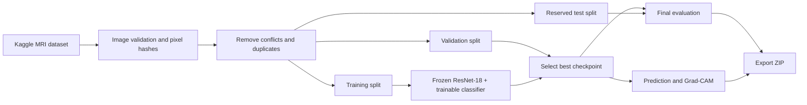

# Brain Tumor MRI

A single notebook that classifies brain MRI images into **glioma, meningioma, no tumor or pituitary tumor** using a ResNet-18 pretrained on ImageNet. It downloads the dataset, checks for duplicate images, trains the final classification layer, evaluates a reserved test set and generates **Grad-CAM visualizations** for individual predictions.

The project covers the complete workflow from image files to an exported model: validation selects the checkpoint, preprocessing stays consistent during inference, and model weights, metadata, predictions and metrics are saved together. The notebook explanations are in Brazilian Portuguese.

**Educational and research use only. This model has not been validated for clinical diagnosis.**

## What was verified

Local checks were run on **November 14, 2026**. The complete dataset was audited, but training and inference were exercised on a small subset to verify execution. **No full-dataset accuracy or GPU timing is claimed.**

| Check | Result |
| --- | --- |
| Dataset integrity | Read and hashed all **7,200 images** in the local version 2 download. |
| Duplicate audit | Found **111 distinct pixel hashes shared between the original training and test folders**. Removed **322 duplicate occurrences** overall; no conflicting labels were found. |
| Clean split | **4,239 training**, **1,060 validation** and **1,579 test** images, with no identical pixel hashes shared across splits. |
| Execution check | Ran one training epoch and the remaining workflow on **64 real images**: 32 training, 16 validation and 16 test. |
| Frozen backbone | Confirmed that only the final classifier changed; backbone parameters and BatchNorm buffers remained unchanged. |
| Save and reload | Confirmed that the reloaded model produced the same predictions. |
| Grad-CAM | Checked frozen weights, execution inside `inference_mode`, state restoration, hook cleanup, invalid inputs and an empty heatmap. |
| Export | Checked ZIP integrity and the expected model, metadata, metrics, predictions and visualization files. |
| Full training and Colab GPU | **Not run.** The execution check establishes that the workflow runs, not that the classifier is accurate. |

The notebook contains assertions for class coverage, split overlap, tensor shapes, finite outputs, frozen BatchNorm buffers and model reload consistency. The additional checks above were performed locally; this repository does not include a CI test suite.

## How it works

[brain_tumor_colab.ipynb](brain_tumor_colab.ipynb) runs these steps in order:

1. **Download and inspect.** Fetch version 2 through KaggleHub, require the four expected classes, validate each image and compute SHA-256 hashes of its decoded RGB pixels and dimensions.
2. **Clean and split.** Exclude conflicting labels and retain one copy of each identical image. When an image appears in both original folders, keep the test copy. Reserve 20% of the remaining training images for stratified validation.
3. **Preprocess.** Convert to RGB, resize with padding to preserve aspect ratio and normalize with ImageNet statistics. Apply light rotation and zoom only during training.
4. **Train.** Freeze the pretrained ResNet-18 and train only its final linear layer: **2,052 trainable parameters**. Keep the backbone in evaluation mode so BatchNorm statistics remain frozen too.
5. **Select.** Save the checkpoint with the lowest validation loss. Stop after three consecutive epochs without improvement, up to the configured maximum.
6. **Evaluate.** Report accuracy, balanced accuracy, macro F1, per-class precision and recall, a confusion matrix and a majority-class baseline on the cleaned test set.
7. **Reload and explain.** Reconstruct the model from its saved weights and metadata, predict a JPEG/PNG image and compute Grad-CAM with PyTorch operations. No additional Grad-CAM package is required.
8. **Export.** Package the model and results into a ZIP and download it from Colab.

### Default configuration

| Setting | Default | Variable |
| --- | --- | --- |
| Dataset | `masoudnickparvar/brain-tumor-mri-dataset/versions/2` | `DATASET_HANDLE` |
| Local dataset | Download through KaggleHub | `DATA_DIR = None` |
| Image size | 224 × 224 | `IMAGE_SIZE` |
| Batch size | 32 | `BATCH_SIZE` |
| Maximum epochs | 5 | `EPOCHS` |
| Validation fraction | 20% of cleaned original training data | `VALIDATION_FRACTION` |
| Optimizer | Adam, learning rate `1e-3` | `LEARNING_RATE` |
| Random seed | 42 | `SEED` |

## What makes this project strong for AI Engineer roles

| Skill | Where to look |
| --- | --- |
| **Data leakage controls.** Exact-pixel deduplication, explicit conflict handling and an auditable split manifest. | Notebook sections 2–3 |
| **Transfer learning.** A pretrained image backbone with only its final layer trained and BatchNorm statistics held fixed. | Sections 4–5 |
| **Evaluation discipline.** Validation selects the model; the test set is reserved for final metrics, including class-level results and a simple baseline. | Sections 5–6 |
| **Reproducible inference.** Saved preprocessing metadata, class order, library versions and an assertion that reload preserves predictions. | Section 7 |
| **Model interpretability.** Class-specific Grad-CAM, restored model state and explicit limits on what a heatmap means. | Section 8 |
| **Artifact delivery.** Model, metrics, predictions and data decisions bundled into a downloadable archive. | Section 9 |

## Quickstart

### Google Colab

1. Click **Open in Colab** at the top of this page.
2. Select **Runtime > Change runtime type > T4 GPU**, if available.
3. Select **Runtime > Run all**. The first run needs internet access to install dependencies and download the dataset and ImageNet weights.
4. Download the ZIP produced by the export cell before ending the session.

GPU availability varies. The notebook falls back to CPU when CUDA is unavailable, which makes training slower.

### Local Jupyter

Open the notebook with a Python 3.11 or 3.12 kernel that has `pip` available, then run its installation cell and the remaining cells in order. If the kernel requests a restart after installation, restart it and continue from the imports.

To use an existing download, set `DATA_DIR` to the directory containing both `Training/` and `Testing/`. There is no separate application or command-line entry point.

### Predict another image

Upload a JPEG or PNG through Colab's **Files** panel, replace `IMAGE_PATH` in section 7 with its path and rerun the prediction and Grad-CAM cells. Set `TARGET_CLASS` to a class name to explain that class, or leave it as `None` to explain the predicted class.

The model accepts 2D image files. It does not process DICOM studies or 3D MRI volumes.

## Data decisions

The source is [Masoud Nickparvar's Brain Tumor MRI Dataset](https://www.kaggle.com/datasets/masoudnickparvar/brain-tumor-mri-dataset), pinned to [version 2](https://www.kaggle.com/datasets/masoudnickparvar/brain-tumor-mri-dataset/versions/2). The local download audited here contained 1,400 training images and 400 test images per class. The public dataset description lists 7,023 images, so the notebook measures the actual files instead of relying on the description.

| Decision | Why |
| --- | --- |
| Hash decoded RGB pixels and dimensions | Detect identical image content even when filenames differ. |
| Exclude all occurrences with conflicting labels | Avoid choosing a label arbitrarily. |
| Prefer the test copy of a cross-split duplicate | Keep an identical training image out of the development data. |
| Create validation only from the original training folder | Keep test results out of checkpoint selection. |
| Save exclusions and split membership | Make the evaluated population inspectable. |

The raw dataset is downloaded separately and is not included in this repository. Metrics refer to the **cleaned test set**, so they are not directly comparable with scores measured on the original test folder.

## Exported files

Each run writes to `brain_tumor_results/<timestamp>/` and exports a ZIP beside that directory.

| File | Contents |
| --- | --- |
| `best_model.pt` | Full model state, including frozen weights and BatchNorm buffers. |
| `metadata.json` | Classes, architecture, preprocessing, configuration and library versions. |
| `history.csv` | Training and validation loss and accuracy by epoch. |
| `metrics.json`, `classification_report.json` | Overall and per-class evaluation results. |
| `test_predictions.csv` | Test labels, predicted classes and model scores. |
| `split_manifest.csv` | Image paths, hashes, labels and final split membership. |
| `excluded_conflicts.csv`, `excluded_duplicates.csv` | Records removed during the audit. |
| `gradcam.png` | Input image, heatmap and overlay for the selected image. |

## Limitations

- **No clinical validation.** A `notumor` prediction does not establish the absence of disease. Softmax scores are not calibrated clinical probabilities.
- **No patient-level split.** Exact hashes do not detect recompressed copies, crops or different images from the same patient. The split does not establish generalization to new patients or hospitals.
- **Grad-CAM is qualitative.** The original spatial map is 7 × 7 and is enlarged for display. It is not a tumor segmentation, and heat over a lesion does not prove the prediction is correct.
- **Full model quality remains unmeasured.** The local execution check used one epoch and a small subset. Run the full notebook before reporting performance.
- **Reproducibility has limits.** A fixed seed and recorded package versions help audit a run; hardware and parallel operations can still produce numerical differences.
- **Colab storage is temporary.** Download the exported ZIP before the runtime is deleted.

## Troubleshooting

- **`No module named pip`:** the selected local Jupyter kernel does not provide `pip`. Use a kernel with `pip` installed, or run the notebook in Colab.
- **`No module named kagglehub`:** the installation cell did not finish in the active kernel. Run it successfully before the imports.
- **Kaggle authentication error:** follow the [official KaggleHub authentication instructions](https://github.com/Kaggle/kagglehub#authentication), or download the dataset manually and set `DATA_DIR`. Do not put credentials in the notebook.
- **Out of memory:** lower `BATCH_SIZE` and rerun the setup and training cells.
- **Unexpected classes or unreadable images:** fix the reported dataset path or file. The notebook stops instead of silently discarding corrupt inputs.
- **Empty Grad-CAM:** the selected class had no positive contribution at the inspected layer. The notebook keeps the map empty rather than inventing a highlighted region.

## Tech stack and references

[PyTorch](https://pytorch.org/) and [TorchVision](https://docs.pytorch.org/vision/stable/index.html) for the model and image transforms, [KaggleHub](https://github.com/Kaggle/kagglehub) for data access, scikit-learn for splitting and metrics, and pandas, NumPy, Pillow and Matplotlib for data inspection and visualization.

- [PyTorch transfer learning tutorial](https://docs.pytorch.org/tutorials/beginner/transfer_learning_tutorial.html)
- [ResNet-18 documentation](https://docs.pytorch.org/vision/stable/models/generated/torchvision.models.resnet18.html)
- [Grad-CAM: Visual Explanations from Deep Networks via Gradient-based Localization](https://arxiv.org/abs/1610.02391)
- [Google Colab FAQ](https://research.google.com/colaboratory/faq.html)
